<p align="center">
  <picture>
    <source media="(prefers-color-scheme: dark)" srcset="assets/hero-dark.svg">
    
  </picture>
</p>

<h1 align="center">Eco: keyword research and SEO for your README and website</h1>

<p align="center"><b>Your project, in the words people search.</b></p>

<p align="center">
  
  
  
</p>

<p align="center">
  <a href="#why-cant-people-find-my-project">Why</a> ·
  <a href="#will-it-change-my-text">Your text</a> ·
  <a href="#how-do-i-know-it-worked">Results</a> ·
  <a href="#how-do-i-start">Start</a> ·
  <a href="#what-cant-it-do">Limits</a> ·
  <a href="#where-can-i-read-more">More</a>
</p>

---

**Eco finds the words people type into search engines and puts them in your README or website.**
It is a pair of skills for Claude Code and other AI agents: `eco-readme` for a GitHub README and
`eco-site` for a website. You don't need to know SEO to use it. Eco does the keyword research,
rewrites the few places Google and GitHub read, and checks every change with a script instead of
asking you to trust it.

## Why can't people find my project?

<p align="center"><picture>
  <source media="(prefers-color-scheme: dark)" srcset="assets/readme/match-dark.svg">
  
</picture></p>

Search engines match words. If people type "github readme banner" and your title says "an
animated SVG hero", one word is missing and the search walks past you. A page titled "your agent
doesn't read the web" never meets people searching for a "web scraping mcp server".

Both examples come from real Eco runs, on a README and on a homepage: the old title and the one
Eco wrote. Eco collects what Google, Bing and
DuckDuckGo suggest while people type, and what already ranks, so the words come from searches,
not guesses.

## Will it change my text?

<p align="center"><picture>
  <source media="(prefers-color-scheme: dark)" srcset="assets/readme/places-dark.svg">
  
</picture></p>

Only where it counts, and you see all of it:

- **A few places only.** In a README: the title, the first lines, headings, image alt text, and
  your GitHub About and topics. On a website: each page's title, meta description, headings and
  link preview.
- **Pages search engines can reach.** On a website, Eco also checks robots.txt, the sitemap and
  page speed.
- **No stuffing.** Each phrase goes where it reads naturally, and nothing the project can't back
  is added.
- **Before and after.** The report shows every line it changed next to the original.
- **Nothing is committed for you.** Eco never commits, pushes or edits GitHub on its own. Changes
  outside the repo come as an exact `gh repo edit` command for you to run.

Each run, step by step, is in [docs/how-it-works.md](docs/how-it-works.md).

## How do I know it worked?

<p align="center"><picture>
  <source media="(prefers-color-scheme: dark)" srcset="assets/readme/track-dark.svg">
  
</picture></p>

1. **Before you get the report**, a script checks that every phrase sits where it should and that
   nothing broke. It refuses to finish until each check passes.
2. **You publish** the changes. Search engines need days or weeks to notice them.
3. **Then run `eco.py track`.** It repeats the searches saved during the research and gives each
   one a verdict: improved, no change, worse, or too early to tell.

For a website, `eco.py gsc` also compares your Search Console data from before and after. All the
details are in [docs/measuring-results.md](docs/measuring-results.md).

## How do I start?

<p align="center"><picture>
  <source media="(prefers-color-scheme: dark)" srcset="assets/readme/start-dark.svg">
  
</picture></p>

In Claude Code, as a plugin:

```text
/plugin marketplace add ilien-dev/eco
/plugin install eco@eco
```

Then open your project and type the command:

| You want | Plugin | `npx skills` |
|---|---|---|
| A README people find on Google and GitHub | `/eco:eco-readme` | `/eco-readme` |
| A website people find on Google and AI search | `/eco:eco-site` | `/eco-site` |

> [!IMPORTANT]
> Type the command and Eco runs. Asking "improve my SEO" in plain words will not start Eco, because a run
> takes a while and changes your text.

<details><summary><b>Other agents, with npx skills</b></summary>

```bash
npx skills add ilien-dev/eco
```

`eco-site` also needs Node.js 18 or newer.

</details>

## What can't it do?

- **Links and stars.** Other sites linking to you count too, and they're up to you.
- **Same-day results.** Search engines take days or weeks to move.
- **Proof of cause.** It measures that a position moved, not that Eco moved it.
- **Websites are new.** `eco-site` and everything added in 0.2.0 has passed the test suite but
  hasn't been through a full run on a real website yet.

The full list is in [docs/limits.md](docs/limits.md).

## Where can I read more?

- [How a run works, step by step](docs/how-it-works.md)
- [Every check the script runs](docs/checks.md)
- [Websites: robots.txt, sitemap, llms.txt and Lighthouse](docs/eco-site.md)
- [Measuring your position after you publish](docs/measuring-results.md)
- [All the limits](docs/limits.md)

## License

MIT, see [LICENSE](LICENSE).
